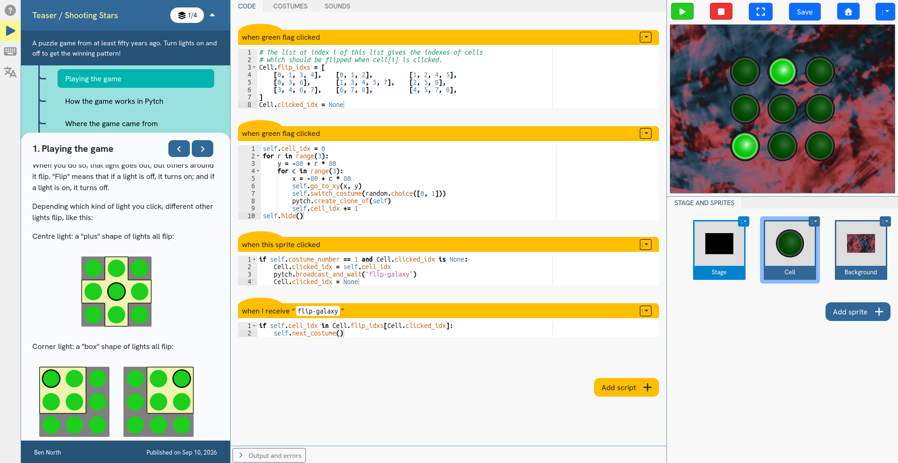
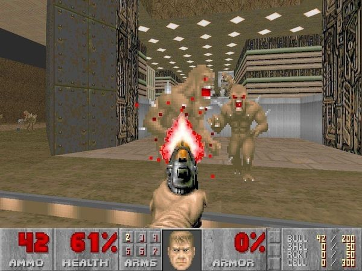

# "But can it run Doom?"

Some time ago now, a colleague and I were running a coding workshop
for young people, using Pytch.  We were talking with the club's
facilitator about Pytch, and he asked the age-old question: _But can
it run Doom?_

The obvious answer was "no, sorry, this is just a 2D system", but the
question nagged at me, and eventually I put some time into thinking
properly about whether Pytch could do _something_ which was _a bit
like_ Doom.

It could!

VIDEO

## Background

[**Pytch**](https://pytch.org/) is a system for teaching people Python
coding, providing an environment which is very close to MIT's Scratch.
The graphical output consists of two-dimensional "sprites", which can
wear "costumes" of the coder's choosing and appear at a chosen
location, size, and rotation.  This is the only way graphics can be
generated.

Many people will be familiar with **Doom**.  It was a PC game released
in 1993, with 3D first-person views which were extremely impressive
for the hardware of that era.  In the years since then, Doom has been
made to run on various surprising systems:

* [A graphical calculator](https://doomwiki.org/wiki/NDoom)
* [A lawnmower](https://boingboing.net/2024/02/27/doom-on-husqvarna-lawnmowers.html),
  at least temporarily.
* [TypeScript's type system](https://simonwillison.net/2025/Feb/27/typescript-types-can-run-doom/)
* [A SQL database](https://cedardb.com/blog/sqldoom/)

Can we add Pytch to the list?

## Research and reference

I had, long ago, done some reading on Doom's binary space partition
(BSP) mechanism, and how it enabled its rendering efficiency.  I
needed to refresh my memory on how this worked.  These resources were
very useful in doing so:

* The [Game Engine Black Book:
  DOOM](https://fabiensanglard.net/gebbdoom/) by Fabien Sanglard.
* The [Linux DOOM](https://github.com/id-Software/DOOM) source code.

## Cutting down the scope

The full game of Doom has multiple levels, monsters, weapons, sound
effects, and much more.  To have a realistic chance of declaring
success, I had to cut the scope right down.  Combining the above
research with some quick experiments, and with knowledge of what would
be possible in Pytch, I came up with the following.

The player should be able to move round a simplified level from the
original shareware Doom, with its first-person view.  Walls should be
rendered as Doom does, but height information can be discarded, and
floor graphics, steps, windows, and similar, need not be implemented.

I took the "Episode 1, Mission 3" map:

and reduced it just to its boundary:

This threw away a lot of detail, but the hope was that it would still
be recognisably Doom-like.

## Implementation of rendering

One approach would be to have one sprite-clone per pixel of a 320×240
screen, changing their colours every frame.  But quick tests showed
that it was completely infeasible to make this work at a reasonable
frame rate.

Instead, to render the player's view, the Pytch program has 320 clones
of an "texture slice" sprite.  That sprite has one costume for every
pixel-column of every texture image used in the level (3,056 in
total).  Every frame, the code computes what slice of what texture at
what scale should be shown in that display column, and the sprite
switches to that costume and sets its size as needed.  There is also
some vertical adjustment to get the "bobbing point-of-view" effect.

Pytch cannot read files, so the required data from the WAD file is
converted into hard-coded Python lists and included in the program.

The overall Python code, suitable for running under Pytch, is a
mixture of hand-written Python code for the algorithms and the
generated code for the data describing the level.  A top-level script
pulls everything together to make a lump of Python which Pytch can
run.  It comes to around 2,000 lines, around 45% code and 55% data.

### Details

To prevent the player walking out of the level, I shrank the boundary
wall by a small amount to get the region where the player is allowed
to be:

The code then makes sure the player didn't cross that smaller
polygon's boundary, using a very similar idea to the original Doom's
"blockmap".

In the original Doom, there is careful use of, among other tricks,
fixed-width integer arithmetic and look-up tables for trigonometric
functions.  It also has many other clever optimisations.  I instead
just used standard Python floating-point arithemetic, the usual
`math.sin()` and friends, standard Python lists, and so on.  This
turned out to be quick enough, and to almost always work fine,
although there is the occasional glitch (e.g., at around 04:05 in the
above video), where I suspect some rounding didn't quite come out
right.  Investigating and fixing this could be future work.

Computers are quite fast these days, even when running Python
transpiled to Javascript (via Skulpt) and running in the browser.  One
change which made a big difference to rendering speed was getting the
column sprites to switch costume by index rather than by costume name,
thereby saving something like 28 million Python string comparisons
(converted to Javascript) per second.

Part-way through development, Chrome had an update which broke
Pytch-Doom.  The problem seems to be that recent Chrome versions
impose a limit on the number of images a page can load.  Firefox works
fine.

## Development workflow

I did some prototyping in Jupyter notebooks, which made it easier to
try out test cases and explore the WAD data.  I then moved the pieces
of code across to standalone Python files.

These tools and libraries were very useful:

* The [Eureka WAD editor](https://eureka-editor.sourceforge.net/)
* The [omgifol Python library](https://github.com/devinacker/omgifol)
* The [shapely Python library](https://github.com/shapely/shapely) for
  calculations involving polygons

## Results

In its limited scope, it works!  It runs at a respectable frame-rate
of 60fps on my desktop machine and looks like the video at the top of
this post.

## Thoughts

There isn't really anything new here, but it was fun to do all the
same.  The task was mostly the engineering work of porting Doom's
algorithms and C code to Python, and representing the required data in
code.

I think this _just about_ counts as "running something Doom-like".

As an unexpected bonus, the "fade to black in the distance" effect of
the original Doom came for free.  When rendering a one-pixel wide
image at a scale of less than one, the browser anti-aliases by making
the image strip partially transparent, allowing some of the dark
background to show through.

It was good to be reminded of the very clever algorithms and
processor-tuned engineering used by the original Doom.

As you can see in the video, I am not very good at this kind of game.
My poor sense of direction doesn't help.

## Source code

All the code is available in this GitHub repository:

* [Pytch Doom git repository](https://github.com/bennorth/pytch-doom)

Look in the `build` directory for details of how to
reconstruct the Pytch project within [the Pytch
webapp](https://pytch.org/).

## Statement on AI usage

I did not use AI while exploring and writing the original code.  Where
would be the fun in that?  But in preparing this post, I did use
Claude to extract some of the standalone scripts in the `build/`
directory from the various hacky notebooks and scripts that I had
written while developing the ideas.  I also used Claude to hack in a
quick extension to Pytch to allow frame-perfect recording of the
rendering, and to hack up a script to produce an MP4 file.

## Image credits

Created by me for this blog post, except:

* Doom screenshot: [Computer History
  Museum](https://www.computerhistory.org/revolution/computer-games/16/202/855)
* Game Engine Black Book cover:
  [https://fabiensanglard.net/gebbdoom/](Fabien Sanglard)
